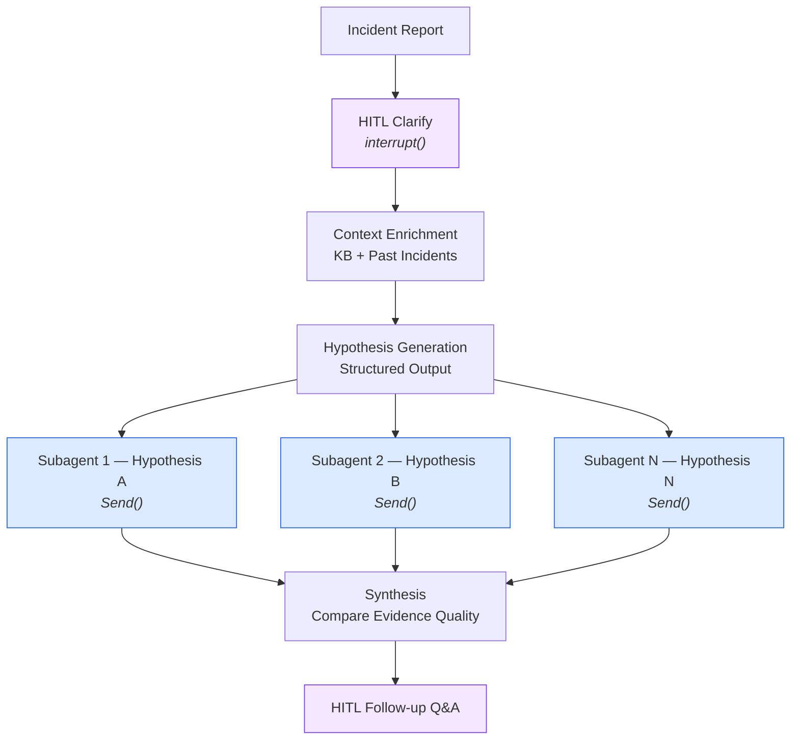

# Deep Research RCA Agent with Human-in-the-Loop

A reference architecture for AI-powered Root Cause Analysis using the **Deep Research pattern** with Amazon Bedrock. This sample demonstrates how to build an interactive investigation agent that clarifies incidents with engineers, generates hypotheses, and investigates them in parallel using dynamically spawned subagents.

> **Important:** This application uses various AWS services and there are costs associated with these services after the Free Tier usage — please see the [AWS Pricing page](https://aws.amazon.com/pricing/) for details. You are responsible for any AWS costs incurred. No warranty is implied in this example.

## Architecture



## Key Patterns Demonstrated

| Pattern | Implementation | Why It Matters |
|---------|----------------|----------------|
| **Human-in-the-Loop** | `interrupt()` for clarification | Prevents misdiagnosis from vague incident reports |
| **Deep Research** | Parallel hypothesis investigation | Faster, more thorough analysis than sequential |
| **Dynamic Agent Spawning** | `Send()` per hypothesis | Scales investigation with problem complexity |
| **Token Streaming** | `streaming=True` + `stream_mode="messages"` | Real-time token-by-token output to all frontends |
| **Structured Output** | Pydantic models for hypotheses | Reliable extraction, type-safe orchestration |
| **Context Enrichment** | Runbooks + past incidents | Leverages institutional knowledge |

## Quick Start

There are two ways to run the agent: **Local** (file-based logs, requires Bedrock KB) or **Deploy** (full AWS stack).

### Prerequisites

- Python 3.11+
- AWS account with Bedrock access (Claude models)
- AWS credentials configured

### Local (requires Bedrock Knowledge Base)

Reads logs from `scenarios/*/evidence/*.log` files on disk. Context retrieval uses Bedrock Knowledge Base (semantic search), so `BEDROCK_KB_ID` is required even in local mode.

```bash
git clone https://github.com/aws-samples/deep-research-rca-agent.git
cd deep-research-rca-agent
pip install -r requirements.txt

export BEDROCK_KB_ID=<your-kb-id>   # Required — deploy first, or use an existing KB

# CLI — interactive HITL investigation
python src/run_demo.py volte-call-drop-handover

# Web UI — start API + frontend
uvicorn src.api:app --reload --port 8000
cd frontend && bun install && bun run dev   # open http://localhost:5173
```

### Deploy (full AWS stack)

Deploys Amplify + Cognito + AgentCore + Knowledge Base + Athena in one command. The deploy script handles everything in 8 steps: manifest generation, frontend build, CDK deploy, KB ingestion, log upload to S3, and Amplify redeploy with real config.

```bash
# Recommended — handles all 8 steps automatically:
./scripts/deploy.sh --admin-email you@example.com

# Or deploy CDK directly (then manually ingest KB + upload logs):
cd deployment/agentcore && npm install
npx cdk deploy --all -c adminEmail=you@example.com
```

After deployment, the frontend URL and AgentCore endpoint are printed in the stack outputs. See [Deployment Guide](docs/deployment-guide.md) for details.

## Scenarios

| Scenario | Domain | What It Demonstrates |
|----------|--------|----------------------|
| `volte-call-drop-handover` | Telecom / VoLTE | Multi-vendor handover failure investigation |
| `iot-fleet-disconnect-cascade` | IoT / Fleet Management | Cascading disconnection across device fleet |
| `k8s-canary-silent-poisoning` | DevOps / Kubernetes | Silent canary deployment corruption |
| `ml-training-drift-schema-migration` | ML / Data Platform | Schema migration causing training drift |
| `care-transcript-supply-chain` | Ops / Supply Chain | Care transcript pipeline with supply chain impact |

Each scenario includes an incident report, evidence logs, context files (runbooks, past incidents, architecture), and ground truth for evaluation. Use the **Create Your Own Scenario** guide in the frontend to add custom scenarios, or follow the [KB Data Pipeline](docs/deployment-guide.md#uploading-your-own-context-data) docs.

### Verifying Scenarios (E2E Tests)

After deploying and ingesting context data into the Knowledge Base, run the e2e test suite to verify the agent finds the correct root cause for all scenarios:

```bash
BEDROCK_KB_ID=<kb-id> AWS_REGION=us-west-2 python scripts/run_all_scenarios_e2e.py
```

This runs all 5 scenarios in parallel (~5 min total) and checks synthesis reports for root-cause keywords. See [End-to-End Scenario Testing](docs/deployment-guide.md#end-to-end-scenario-testing) for details.

## Adapting for Your Environment

The sample uses a **pluggable data source pattern**. Implement the `BaseDataSource` interface in `src/data_sources/base.py` to connect your own log infrastructure:

```python
from data_sources.base import BaseDataSource, SearchResponse, SearchResult

class MyCustomDataSource(BaseDataSource):
    def search(self, query, time_start, time_end, filters=None, limit=10):
        results = self._query_your_system(query, time_start, time_end)
        return SearchResponse(
            query=query, time_start=time_start, time_end=time_end,
            results=[SearchResult(content=r["message"], timestamp=r["ts"], source=r["service"]) for r in results],
            total_matches=len(results)
        )
```

Built-in adapters: file-based (local), S3+Athena, CloudWatch Logs, OpenSearch (managed and Serverless). Context retrieval uses Amazon Bedrock Knowledge Base with S3 Vectors backend and semantic search. See [Deployment Guide](docs/deployment-guide.md) for backend configuration.

## Project Structure

```
src/
├── rca_agent.py              # Main LangGraph implementation with HITL
├── run_demo.py               # Demo runner (HITL version)
├── api.py                    # FastAPI server with SSE streaming
├── agentcore_app.py          # BedrockAgentCoreApp runtime wrapper
├── auth.py                   # Cognito JWT validation
├── config.py                 # Configuration management
├── config_loader.py          # DynamoDB-backed hot-reloadable config
├── checkpoint.py             # Checkpointer factory (memory/sqlite/dynamodb)
├── stream_formatter.py       # Shared SSE/structured event formatting
├── mcp_client.py             # MCP tool server client (SigV4 support)
├── telemetry.py              # OpenTelemetry decorators for tracing
├── tool_registry.py          # Pluggable tool registry with enable/disable
├── data_source_factory.py    # Factory for creating data sources
└── data_sources/             # File-based, S3+Athena, CloudWatch, OpenSearch
scenarios/                    # 5 investigation scenarios
deployment/agentcore/         # CDK for AgentCore + Amplify + Cognito + KB + Athena
tests/                        # pytest test suite (455 tests)
```

## Deployment Details

OpenSearch Serverless is the only opt-in add-on (`--deploy-opensearch`, ~$350/month). Everything else is deployed by default.

See [Deployment Guide](docs/deployment-guide.md) for production setup, log backend configuration, and troubleshooting.

## Cost Estimation

### Local Mode — ~$1-5/month (+ Bedrock usage)

Context retrieval requires a Bedrock Knowledge Base (S3 Vectors backend) in all modes. Local mode uses file-based log search but still needs KB infrastructure for semantic search.

| Component | Monthly Cost | Notes |
|-----------|--------------|-------|
| **Bedrock Knowledge Base** (S3 Vectors) | ~$1-5 | Storage + embedding calls on sync |
| **Bedrock Claude** | Usage-based | ~$3/M input + ~$15/M output tokens (Sonnet) |

### Deploy Mode — ~$5-30/month (+ Bedrock usage)

The `deploy.sh` script deploys all components below. Costs are dominated by usage, not idle infrastructure.

| Component | Monthly Cost | Notes |
|-----------|--------------|-------|
| **Amplify Hosting** | ~$0-1 | Free tier: 1,000 build min + 15 GB served |
| **Cognito** | $0 | Free tier: 50,000 MAUs |
| **AgentCore Runtime** | Usage-based | Pay per invocation |
| **DynamoDB** (checkpoints + config) | ~$0-1 | On-demand; free tier: 25 GB + 25 WCU/RCU |
| **ECR** | ~$0-1 | ~$0.10/GB/month for container images |
| **Bedrock Knowledge Base** (S3 Vectors) | ~$1-5 | Storage + embedding calls on sync |
| **S3 + Athena** (log search) | ~$1-5 | ~$5/TB scanned; pennies for demo-scale data |
| **Bedrock Claude** | Usage-based | ~$3/M input + ~$15/M output tokens (Sonnet) |

### Optional: OpenSearch Serverless — add ~$350/month

| Component | Monthly Cost | Notes |
|-----------|--------------|-------|
| **OpenSearch Serverless** | ~$350+ | Minimum 2 indexing + 2 search OCUs |

Deploy with `--deploy-opensearch` flag. Only needed for sub-second full-text search at scale.

## Cleanup

```bash
cd deployment/agentcore
npx cdk destroy --all
```

The CDK stacks use `RemovalPolicy.DESTROY` with `autoDeleteObjects: true`, so S3 buckets are automatically emptied and deleted.

## Contributing

See [CONTRIBUTING.md](CONTRIBUTING.md) for guidelines.

## Security

See [CONTRIBUTING.md](CONTRIBUTING.md#security-issue-notifications) for reporting security issues.

## License

This library is licensed under the MIT-0 License. See the [LICENSE](LICENSE) file.

## Related Resources

- [Amazon Bedrock Documentation](https://docs.aws.amazon.com/bedrock/)
- [LangGraph Documentation](https://langchain-ai.github.io/langgraph/)
- [Amazon Bedrock AgentCore](https://docs.aws.amazon.com/bedrock/latest/userguide/agentcore.html)
- [Deployment Guide](docs/deployment-guide.md) — Production backends, CDK stacks, troubleshooting
- [Pattern Deep Dive](patterns/rca-deep-research/README.md) — Detailed AgentCore integration
