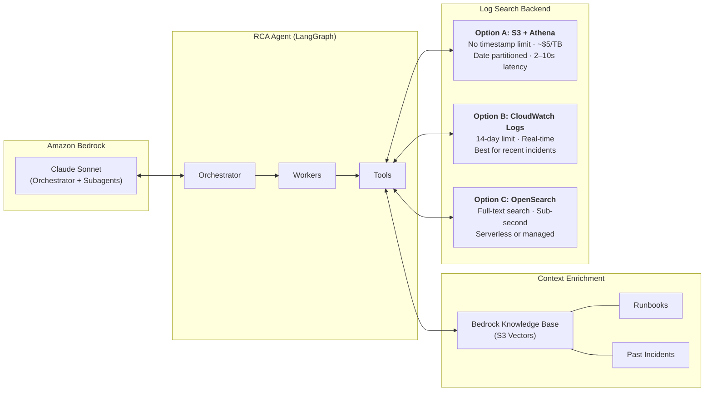

# Deployment Guide

This guide covers production deployment options, log search backend setup, Docker configuration, and troubleshooting.

## HITL Investigation Flow

The diagram below traces the full investigation lifecycle, showing what context each node consumes and produces. The three HITL interrupt points are highlighted in purple.

```mermaid
flowchart TD
    FE["Frontend\nUser selects scenario + types vague incident report\nPOST { scenario_name, incident_text }"]
    API["API Layer — <i>api.py</i>\n\nState created:\n• incident = user's text (incident.md NOT loaded)\n• messages = [HumanMessage(incident)]\n• scenario_name (for evidence lookups)\n• enriched_context = empty"]

    FE --> API

    subgraph phase1 ["Phase 1: Clarification"]
        CLARIFY["clarify_incident\n\nConsumes: incident, messages\nSends: CLARIFICATION_PROMPT + conversation\nReturns: IncidentClarification"]
        HITL1["HITL Interrupt #1\nhuman_input_clarify\n\ninterrupt() — waits for user\nUser provides date + symptoms"]
        EXTRACT["extract_details\n\nConsumes: incident, messages (incl. clarification)\nReturns: IncidentDetails\n• incident_time, time_window (ISO)\n• affected_services, symptoms, summary\nBuilds enriched_context"]

        CLARIFY -- "needs_clarification = true" --> HITL1
        HITL1 -- "loops back" --> CLARIFY
        CLARIFY -- "needs_clarification = false" --> EXTRACT
    end

    subgraph phase2 ["Phase 2: Hypothesis Generation"]
        HYPO["hypothesis_generation\n\nConsumes: enriched_context, current_hypotheses\nReturns 3–4 Hypotheses:\n• service, description, search_terms, rationale"]
        HITL2["HITL Interrupt #2\nhuman_input\n\nUser reviews hypotheses:\n• iterate_on_hypotheses → refine\n• initiate_agents → investigate\n• general_qa → Q&A loop"]

        HYPO --> HITL2
        HITL2 -- "iterate" --> HYPO
    end

    subgraph phase3 ["Phase 3: Investigation"]
        SPAWN["spawn_investigators\n\nConsumes: hypotheses, scenario_name, time_window\nCreates: Send() per hypothesis"]
        WORKER["investigation_reasoning ↔ investigation_tool\n(per worker, up to 5 cycles)\n\nTools: search_logs, lookup_context, think\nOutput: tagged messages per worker"]

        SPAWN --> WORKER
    end

    subgraph phase4 ["Phase 4: Synthesis"]
        SYNTH["synthesize_findings\n\nConsumes: all worker_messages\nGroups by worker, compares evidence quality\nOutput: Root Cause + Evidence + Confidence + Actions"]
        HITL3["HITL Interrupt #3\nhuman_input_post\n\nFollow-up Q&A or 'done' to finish"]

        SYNTH --> HITL3
    end

    API --> CLARIFY
    EXTRACT --> HYPO
    HITL2 -- "investigate" --> SPAWN
    WORKER -- "all workers converge" --> SYNTH

    style HITL1 fill:#f3e8ff,stroke:#7c3aed
    style HITL2 fill:#f3e8ff,stroke:#7c3aed
    style HITL3 fill:#f3e8ff,stroke:#7c3aed
    style WORKER fill:#dbeafe,stroke:#2563eb
    style phase1 fill:none,stroke:#94a3b8
    style phase2 fill:none,stroke:#94a3b8
    style phase3 fill:none,stroke:#94a3b8
    style phase4 fill:none,stroke:#94a3b8
```



## Infrastructure Overview



## Production Mode (CLI)

When running the agent via CLI (not the deployed AgentCore path), you must set environment variables to connect to AWS log backends. The deployed path auto-wires these — see [AgentCore Deployment](#agentcore-deployment).

### Step 1: Upload Scenario Logs

```bash
# S3 + Athena (recommended — no timestamp limits, pay-per-query)
python scripts/upload_logs_to_s3.py --bucket <log-bucket-from-cdk-output> --all

# OpenSearch Serverless (sub-second full-text search, IAM auth)
python scripts/ingest_to_opensearch_serverless.py \
    --endpoint https://<collection-id>.us-west-2.aoss.amazonaws.com \
    --region us-west-2

# CloudWatch Logs (recent incidents only, <14 days — script shifts timestamps)
python scripts/upload_logs_to_cloudwatch.py --scenario volte-call-drop-handover --region us-west-2
```

### Step 2: Set Environment Variables

```bash
# For Athena:
export RCA_AGENT_MODE=production
export LOG_SEARCH_BACKEND=athena
export ATHENA_DATABASE=rca_agent_logs
export ATHENA_TABLE=logs
export ATHENA_OUTPUT_LOCATION=s3://<athena-results-bucket>/
export AWS_REGION=us-east-1

# For OpenSearch Serverless:
export RCA_AGENT_MODE=production
export LOG_SEARCH_BACKEND=opensearch
export OPENSEARCH_ENDPOINT=https://<collection-id>.us-west-2.aoss.amazonaws.com
export OPENSEARCH_INDEX=rca-logs
export OPENSEARCH_AUTH_MODE=iam
export OPENSEARCH_SERVERLESS=true
export AWS_REGION=us-west-2

# For CloudWatch:
export RCA_AGENT_MODE=production
export LOG_SEARCH_BACKEND=cloudwatch
export CLOUDWATCH_LOG_GROUP_PREFIX=/rca-agent/scenarios
export AWS_REGION=us-west-2
```

> **Note:** These environment variables are only needed for CLI usage (`python src/run_demo.py`). The deployed AgentCore path auto-wires Athena config and KB ID from the CDK stacks.

### Step 3: Run the Agent

```bash
python src/run_demo.py volte-call-drop-handover
```

## Log Search Backend Details

### Choosing a Backend

| Consideration | Athena | CloudWatch | OpenSearch Serverless |
|---------------|--------|------------|----------------------|
| **Setup complexity** | CDK stack (S3 + Glue + Athena) | Just log groups | CDK stack (collection + policies) |
| **Query latency** | 2-10 seconds | Sub-second | Sub-second |
| **Timestamp limit** | None | 14 days | None |
| **Cost model** | Per TB scanned (~$5/TB) | Per GB ingested + stored | ~$350/month minimum (OCUs) |
| **Best for** | Historical analysis, demos | Real production incidents | High-scale, low-latency search |

### S3 + Athena Setup

No timestamp restrictions, pay-per-query pricing, SQL-based queries. Uses Glue Data Catalog for schema and partition projection for efficient queries.

```bash
# Athena is deployed automatically with the main stack:
#   npx cdk deploy --all

# Upload all scenarios (date-partitioned)
python scripts/upload_logs_to_s3.py --bucket <log-bucket-name> --all
```

### CloudWatch Logs Setup

CloudWatch Logs has a **14-day ingestion limit** — log events with timestamps older than 14 days are silently rejected. For demo scenarios with historical dates, the upload script shifts timestamps:

```bash
# Upload logs with timestamp shifting + generate matching incident report
python scripts/upload_logs_to_cloudwatch.py --scenario volte-call-drop-handover --region us-west-2

# Run with the generated incident report
python src/run_demo.py volte-call-drop-handover \
    --incident scenarios/volte-call-drop-handover/incident_cloudwatch.md
```

### OpenSearch Serverless Setup

> **Cost warning**: OpenSearch Serverless has a minimum cost of ~$350/month (2 indexing + 2 search OCUs).

```bash
cd deployment/agentcore && npm install

# Deploy with OpenSearch (adds ~$350/month)
npx cdk deploy --all -c deployOpenSearch=true

# Set up local dev profiles (creates opensearch-ingestion + rca-agent profiles)
./scripts/setup-opensearch-profiles.sh

# Upload scenario logs
AWS_PROFILE=opensearch-ingestion python scripts/ingest_to_opensearch_serverless.py \
    --endpoint <CollectionEndpoint> --region us-west-2

# Run the agent
AWS_PROFILE=rca-agent \
OPENSEARCH_ENDPOINT=<CollectionEndpoint> \
OPENSEARCH_INDEX=rca-logs \
OPENSEARCH_SERVERLESS=true \
LOG_SEARCH_BACKEND=opensearch \
RCA_AGENT_MODE=production \
python src/rca_agent.py volte-call-drop-handover
```

## AgentCore Deployment

Deploy the RCA agent as a managed service on Amazon Bedrock AgentCore with built-in memory, authentication, and scaling.

```bash
cd deployment/agentcore && npm install

# Deploy everything (Amplify + Cognito + AgentCore + KB + Athena)
npx cdk deploy --all -c adminEmail=you@example.com
```

**AgentCore features included:**
- `BedrockAgentCoreApp` runtime wrapper (`src/agentcore_app.py`)
- Token-level streaming via `stream_mode="messages"`
- DynamoDB-backed checkpointing for durable state
- AgentCoreMemorySaver auto-detection via `MEMORY_ID` env var
- DynamoDB hot-reloadable config (`src/config_loader.py`)
- MCP tool server integration with SigV4 auth
- Investigation trajectory capture for evaluation
- OpenTelemetry instrumentation with X-Ray propagation
- Pluggable tool registry with `ENABLED_TOOLS` env var filtering

See [patterns/rca-deep-research/README.md](../patterns/rca-deep-research/README.md) for detailed integration docs.

## Knowledge Base Deployment

The agent uses [Amazon Bedrock Knowledge Bases](https://docs.aws.amazon.com/bedrock/latest/userguide/knowledge-base.html) to semantically search runbooks and past incidents in all modes (local and production). `BEDROCK_KB_ID` is required — there is no flat-file fallback for context retrieval.

```bash
# Knowledge Base is deployed automatically with the main stack.
# The KB ID is auto-wired into the AgentCore Runtime — no manual export needed.
npx cdk deploy --all

# To auto-upload sample scenarios to the KB:
npx cdk deploy --all -c syncSampleData=true
```

For **CLI usage** (not the deployed path), set the KB ID manually:

```bash
export BEDROCK_KB_ID=<kb-id-from-cdk-output>
```

> **Tip**: To use your own existing knowledge base instead of the CDK-deployed one, pass it via context: `npx cdk deploy --all -c knowledgeBaseId=YOUR_KB_ID`. This overrides the deployed KB and wires your KB ID into the runtime.

### KB Storage Backend and Search Type

The CDK stack deploys the KB with **S3 Vectors** as the storage backend — a pay-per-query vector store that is ~90% cheaper than OpenSearch Serverless for this use case. S3 Vectors uses Amazon Titan Embed Text V2 (1024-dimensional embeddings) and supports **SEMANTIC search only** (not HYBRID).

If you need HYBRID search (BM25 keyword + semantic), you would need to change the CDK stack to use OpenSearch Serverless as the KB storage backend. For the included scenarios, semantic-only search is sufficient (5/5 scenarios pass with full keyword coverage).

The agent's `BedrockContextSource.search()` does not force a search type — Bedrock KB automatically uses the optimal strategy for whatever storage backend is configured.

### Uploading Your Own Context Data

The KB is populated with context files (runbooks, past incidents, architecture docs) that workers retrieve during investigation. There are three ways to upload data:

**Option A: Auto-sync on deploy** (simplest for sample scenarios)

```bash
npx cdk deploy --all -c syncSampleData=true
```

This uploads all `scenarios/*/context/` files to the KB S3 bucket and triggers ingestion automatically during deployment.

**Option B: Use the ingest script** (per-scenario, also uploads logs to OpenSearch)

```bash
cd deployment/agentcore
./scripts/ingest-scenario.sh volte-call-drop-handover
```

The script syncs context files to `s3://<kb-bucket>/scenarios/<name>/context/`, then triggers a KB ingestion job. It also uploads evidence logs to OpenSearch if configured.

**Option C: Manual upload** (for custom data or non-scenario content)

```bash
# Upload your markdown files to the KB S3 bucket
aws s3 sync /path/to/your/context/ s3://<kb-bucket>/my-context/ --region us-west-2

# Trigger ingestion
aws bedrock-agent start-ingestion-job \
  --knowledge-base-id <kb-id> \
  --data-source-id <datasource-id> \
  --region us-west-2
```

Get the bucket name, KB ID, and data source ID from CDK outputs:
```bash
aws cloudformation describe-stacks --stack-name RcaKnowledgeBaseStack \
  --query 'Stacks[0].Outputs' --output table --region us-west-2
```

### Document Size Constraints (S3 Vectors)

S3 Vectors has a **2048-byte limit on filterable metadata per vector record**. When Bedrock KB chunks your documents and generates embeddings, it also stores metadata (source URI, chunk index, etc.) alongside each vector. Large documents that produce many chunks can hit this limit, causing ingestion failures.

**Symptoms**: Ingestion completes but `numberOfDocumentsFailed` > 0. The `failureReasons` field shows `Filterable metadata must have at most 2048 bytes`.

**Fix**: Pre-split large files into smaller documents (~800 bytes each) before uploading to S3. The content is still semantically searchable — splitting just keeps the per-record metadata under the limit.

```python
# Example: split markdown files by paragraph into ~800-byte chunks
import re
from pathlib import Path

MAX_BYTES = 800
for md_file in Path("context/").glob("*.md"):
    content = md_file.read_text()
    paragraphs = [p.strip() for p in content.split("\n\n") if p.strip()]
    chunk, idx = "", 1
    for para in paragraphs:
        if len((chunk + "\n\n" + para).encode()) > MAX_BYTES and chunk:
            Path(f"split/{md_file.stem}_{idx:03d}.md").write_text(chunk)
            idx += 1
            chunk = para
        else:
            chunk = chunk + "\n\n" + para if chunk else para
    if chunk:
        Path(f"split/{md_file.stem}_{idx:03d}.md").write_text(chunk)
```

### Verifying Ingestion

After ingestion, verify the KB returns relevant results:

```bash
# Check ingestion job status
aws bedrock-agent list-ingestion-jobs \
  --knowledge-base-id <kb-id> \
  --data-source-id <datasource-id> \
  --region us-west-2

# Query the KB
aws bedrock-agent-runtime retrieve \
  --knowledge-base-id <kb-id> \
  --retrieval-query '{"text": "handover timeout"}' \
  --region us-west-2
```

A successful ingestion shows `status: COMPLETE` with `numberOfDocumentsFailed: 0`. The retrieve call should return relevant chunks with similarity scores > 0.6.

## End-to-End Scenario Testing

The e2e test runner executes all 5 scenarios in parallel against the full LangGraph agent — including KB context retrieval, log search, HITL interactions, and synthesis — then checks whether the agent found the correct root cause.

### Prerequisites

- `BEDROCK_KB_ID` set to a KB with ingested scenario context
- AWS credentials with Bedrock model access
- For local mode: scenario evidence files in `scenarios/*/evidence/`

### Running the Tests

```bash
# Run all 5 scenarios in parallel
BEDROCK_KB_ID=<kb-id> AWS_REGION=us-west-2 python scripts/run_all_scenarios_e2e.py

# Run a subset (matches scenario names by substring)
BEDROCK_KB_ID=<kb-id> AWS_REGION=us-west-2 python scripts/run_all_scenarios_e2e.py k8s ml-training
```

Each scenario runs as a separate subprocess via `scripts/run_one_scenario_e2e.py`, which:
1. Loads the scenario's `incident.md`
2. Runs the full LangGraph orchestrator graph
3. Provides pre-written HITL responses at each interrupt point
4. Captures a trajectory of tool calls and timing
5. Returns JSON with the synthesis report

### How Pass/Fail Works

Each scenario has a set of root-cause keywords in `run_all_scenarios_e2e.py`. The synthesis report must contain at least 2 matching keywords to count as PASS. For example, `volte-call-drop-handover` must match 2+ of: `handover`, `timer`, `500ms`, `500`.

### Trajectory Capture

The e2e runner saves investigation trajectories to `trajectories_e2e.json` at the project root. Each trajectory records:
- `total_duration_ms` — wall time for the full investigation
- `tool_calls` — tool name, args, result preview, duration per call
- `session_id` and `scenario_name`

### Expected Results

With the included 5 scenarios and ingested KB context, all 5 should PASS:

```
Running 5 scenarios in parallel...
  [PASS] volte-call-drop-handover — 4/4 keywords
  [PASS] iot-fleet-disconnect-cascade — 5/5 keywords
  [PASS] k8s-canary-silent-poisoning — 7/7 keywords
  [PASS] ml-training-drift-schema-migration — 7/8 keywords
  [PASS] care-transcript-supply-chain — 7/7 keywords

5/5 scenarios found correct root cause
```

Total wall time is ~5 minutes (bounded by the slowest scenario, since all run in parallel).

## Timestamp Handling

| Backend | Timestamp Handling |
|---------|-------------------|
| **LOCAL (file-based)** | Original timestamps preserved |
| **S3 + Athena** | Original timestamps preserved |
| **CloudWatch** | Script shifts timestamps to recent time and generates matching `incident_cloudwatch.md` |

## LangGraph Patterns Used

| Pattern | Location | Purpose |
|---------|----------|---------|
| `StateGraph` | `OrchestratorState`, `WorkerState` | Main orchestration and worker graphs |
| `Send()` | `spawn_investigators()` | Dynamic subagent creation per hypothesis |
| `interrupt()` | `human_input_clarify()`, `human_input()` | HITL pause points for user input |
| `Command` | `route_from_query()` | Conditional routing based on user intent |
| `Annotated[list, operator.add]` | `worker_messages` | Accumulator pattern for subagent results |
| `Checkpointer` | `create_checkpointer()` | Pluggable state persistence (memory/sqlite/dynamodb) |
| Structured Output | `Hypotheses`, `IncidentClarification` | Pydantic models for reliable extraction |

## Extensions for Production

| Feature | Demo Implementation | Production Extension |
|---------|---------------------|---------------------|
| **Log Search** | Keyword substring match | CloudWatch Insights with aggregations |
| **Statistics** | None | % change calculations (current vs previous window) |
| **Search Logic** | Simple keyword | Phrase-based with AND/OR/NOT operators |
| **Trend Analysis** | None | "Log volume increased by X% vs last hour" |
| **Hybrid Search** | Semantic only (S3 Vectors KB) | RRF/Alpha blending (semantic + BM25 via OpenSearch) |
| **Data Sources** | Logs only | JIRA tickets, MS Teams, infrastructure changes |

## Security Considerations

- **VPC-only access**: OpenSearch Serverless is accessible only via VPC endpoint
- **Encryption**: S3 bucket encryption enabled, SSL enforced
- **IAM roles**: Scoped to specific resources and accounts
- **No credentials in code**: Uses IAM roles and boto3 session credentials
- **Sample data**: Uses RFC 5737 documentation IPs (203.0.113.x) and private ranges

For production deployment:
- Consider customer-managed KMS keys for CloudWatch logs

## Troubleshooting

### Agent fails to start
```bash
# Verify AWS credentials
aws sts get-caller-identity

# Check Bedrock model access
aws bedrock list-foundation-models --query 'modelSummaries[?contains(modelId, `claude`)].modelId'
```

### OpenSearch connection errors
```bash
# Verify VPC endpoint exists
aws ec2 describe-vpc-endpoints --filters Name=service-name,Values=com.amazonaws.*.aoss

# Check collection status
aws opensearchserverless list-collections
```

### HITL interrupt not working
Ensure you're using the async API and have a checkpointer configured:
```python
graph = build_orchestrator_graph()  # Uses create_checkpointer()
await graph.ainvoke(state, config)  # Use ainvoke, not invoke
```

For production, set `CHECKPOINT_BACKEND=dynamodb` and `CHECKPOINT_TABLE_NAME`.

### Local mode not finding scenarios
```bash
export SCENARIOS_DIR=/path/to/scenarios
# Or ensure you're running from project root
python src/run_demo.py volte-call-drop-handover
```
